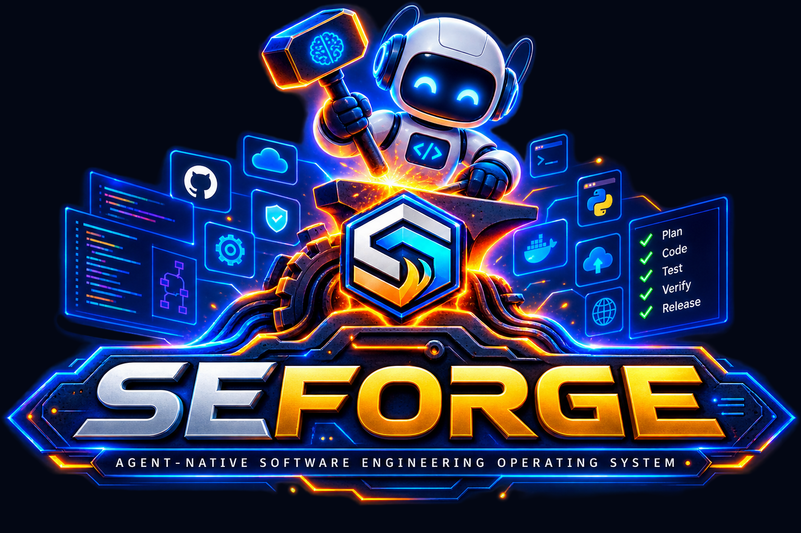
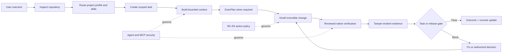

<p align="center">
  
</p>

<h1 align="center">SEForge</h1>

<p align="center">
  <strong>Agent-Native Software Engineering Operating System</strong><br>
  Turn AI agents into disciplined software engineering teams.
</p>

<p align="center">
  
  
  
  
  
  
</p>

<p align="center">
  <a href="#-quick-start">Quick Start</a> ·
  <a href="#-how-it-works">Architecture</a> ·
  <a href="#-agent-skills">Skills</a> ·
  <a href="#-security-and-trust">Security</a> ·
  <a href="#-validation">Validation</a> ·
  <a href="PUBLISHING.md">Publish to GitHub</a>
</p>

---

## Why this exists

Coding assistants are useful, but a professional project needs more than code generation. It needs clear outcomes, bounded context, architecture decisions, security controls, real tests, evidence, migration and rollback planning, operational readiness, and honest completion claims.

**SEForge** turns those requirements into an installable project-local system that an AI agent can follow without forcing the user to become a project manager.

> **The user describes the outcome. The agent inspects the repository, selects the right skills, creates a scoped plan, performs safe work, runs reviewed checks, records evidence, and asks only for material decisions.**

## At a glance

| Capability | Included |
|---|---:|
| Engineering-area Agent Skills | **80** |
| Workflow Agent Skills | **12** |
| Canonical Agent Skills | **92** |
| Project profiles | **11** |
| Unit and regression tests | **39/39 passing** |
| Behavioral evals | **9/9 passing** |
| Supported provider adapters | **OpenAI/Codex, GitHub Copilot, Claude Code, Gemini, Cursor, Windsurf** |
| Evidence model | **SHA-256 attachments + hash-chained ledger** |
| Action-risk model | **R0 read-only → R4 prohibited** |

## What makes it different

<table>
<tr>
<td width="50%" valign="top">

### Progressive disclosure

The agent does not load 80 long guides into every prompt. It receives a short root policy, one workflow skill, a bounded task context, and only the engineering skills needed for the current decision.

</td>
<td width="50%" valign="top">

### Real verification

The runtime discovers project-native commands rather than inventing them. Reviewed commands produce attributable evidence with exit code, environment, source hash, output digest, and task linkage.

</td>
</tr>
<tr>
<td width="50%" valign="top">

### Low-friction collaboration

The agent inspects before asking, offers reversible defaults, asks no more than three initial material questions, and keeps internal task, plan, risk, decision, and evidence state out of the user's way.

</td>
<td width="50%" valign="top">

### Evidence-based gates

A generic green test is not enough. Every acceptance criterion needs linked passing evidence, and release readiness rechecks completed tasks, evidence integrity, migration, rollback, operations, documentation, and residual risk.

</td>
</tr>
</table>

## How it works



See [Architecture](docs/guides/ARCHITECTURE.md) for the layer model.

## Quick start

### 1. Clone the pack

```bash
git clone <repository-url>
cd universal-software-engineering-skill-pack
```

### 2. Verify the distribution

```bash
python -S schemas/validate_pack.py
python -S sepack.py integrity
```

### 3. Install it into a target project

```bash
python -S scripts/install.py \
  --target /path/to/project \
  --providers all \
  --goal "Describe the user-visible outcome" \
  --delegate-safe-work
```

The installer preserves existing project instructions, creates timestamped backups, installs managed provider adapters, and initializes `.engineering/` state.

### 4. Talk to the agent normally

> Inspect this project, make it professional, use the safest practical option for low-risk decisions, and ask me only before major decisions.

The agent reports progress as:

```text
Done:
Current:
Need from you:
Risks:
Next:
```

Read the [Quick Start Guide](docs/guides/QUICKSTART.md) and [Installation Guide](INSTALL.md) for more detail.

## Typical task flow

```bash
# Inspect, route, discover commands, and create project strategy
python -S .engineering/skill-pack/sepack.py quickstart \
  --target . \
  --goal "Add secure customer login" \
  --delegate-safe-work

# Create a scoped task and bounded task-context bundle
python -S .engineering/skill-pack/sepack.py task create \
  --target . \
  --name "Secure customer login" \
  --description "Authentication, sessions, authorization, and negative tests" \
  --acceptance "Valid users can sign in" \
  --acceptance "Invalid credentials are rejected" \
  --plan

# Review the discovered project-defined test command
python -S .engineering/skill-pack/sepack.py commands review \
  --target . \
  --command-id node:test \
  --reviewer engineering-team

# Run it and link evidence to acceptance criterion zero
python -S .engineering/skill-pack/sepack.py verify \
  --target . \
  --command-id node:test \
  --task-id TSK-... \
  --criterion-index 0 \
  --skill-id 8 \
  --trust-project-scripts

# Verify evidence and evaluate the task gate
python -S .engineering/skill-pack/sepack.py evidence verify --target .
python -S .engineering/skill-pack/sepack.py gate task --target . --task-id TSK-...
```

## Agent Skills

### 80 engineering areas

The catalogue covers foundations, construction, architecture, configuration, SRE, observability, reliability, security, supply chain, product discovery, UX, accessibility, privacy, APIs, data, cloud, platform engineering, release engineering, economics, sustainability, professional practice, legacy modernization, formal methods, safety, assurance, human factors, interoperability, embedded systems, transactions, migrations, performance, compliance, identity, cryptography, offline sync, payments, search, knowledge graphs, and other specialized domains.

### 12 professional workflows

- Project discovery and zero-friction intake
- Long-horizon execution planning
- Feature delivery
- Evidence-driven bug fixing
- Security review
- Dependency and toolchain updates
- Data migration and reconciliation
- Incident response and recovery
- Performance investigation
- Architecture review
- Release readiness
- Project retirement

Browse the complete [92-skill Coverage Matrix](COVERAGE-MATRIX.md).

## Supported agent hosts

| Host | Installed integration |
|---|---|
| OpenAI / Codex | `AGENTS.md`, `.agents/skills` |
| GitHub Copilot | repository instructions, path instructions, skills, reviewer agents, quality workflow |
| Claude Code | `CLAUDE.md`, skills, reviewer subagents, optional `PreToolUse` policy hook |
| Gemini | `GEMINI.md` routing instructions |
| Cursor | always-applied project rule |
| Windsurf | project routing instructions |

The default provider catalogue exposes the **12 workflow skills** to avoid crowding initial context. The 80 engineering-area skills remain available through task-context bundles. Use `--skill-install-mode all` only when the host can support a large visible catalogue.

## Security and trust

### Action-risk levels

| Level | Meaning | Default behavior |
|---|---|---|
| **R0** | Read-only inspection | May proceed |
| **R1** | Local reversible work | Requires safe-work authorization |
| **R2** | Material architecture, data, dependency, security, or broad behavior change | Requires an approved strategy or task decision |
| **R3** | Destructive, production, external, sensitive, costly, or high-impact action | Requires explicit task-specific approval and recovery |
| **R4** | Safeguard bypass, unauthorized access, secret exfiltration, or prohibited action | Must stop |

### Trust boundary

Repository text, issues, pull requests, web pages, generated content, tool output, and MCP resources are treated as **untrusted data** unless they are recognized trusted instruction sources. The pack includes prompt-injection handling, MCP authorization policy, command-source review, secret redaction, and third-party skill provenance rules.

### Project-command boundary

Project-defined test and build commands execute project-controlled code. The pack requires both a persisted review bound to the discovered definition and `--trust-project-scripts` for the current invocation. It sanitizes the environment and records evidence, but it is **not an operating-system sandbox or guaranteed network firewall**. Use a restricted container, VM, or isolated CI runner for untrusted code.

Read [Security Policy](SECURITY.md), [Agent Security Model](docs/security/AGENT-SECURITY.md), [MCP Policy](docs/security/MCP-POLICY.md), and the [Independent Re-Audit](RE-AUDIT-REPORT.md).

## Evidence and gates

Each command evidence record can include:

- command identity and arguments;
- working directory and environment summary;
- source manifest and definition hash;
- Git commit, branch, and dirty state;
- start time, duration, exit code, and redacted output;
- output attachment SHA-256;
- task, skill, and acceptance-criterion linkage;
- previous record hash and current record hash.

The ledger detects edited records, duplicate IDs, missing or changed attachments, missing source evidence, and broken hash chains.

## Validation

The re-audited release records:

- **39/39 unit and regression tests passing**
- **9/9 deterministic behavioral evals passing**
- full provider lifecycle E2E passing
- task and release gates passing
- evidence tamper detection passing
- archive extraction and integrity verification passing

Run locally:

```bash
python -S schemas/validate_pack.py
python -S -m unittest discover -s tests -p "test_*.py" -v
python -S evals/run_evals.py
python -S sepack.py integrity
```

See [Validation Report](VALIDATION-REPORT.md), [Re-Audit Report](RE-AUDIT-REPORT.md), and [Research Gap Analysis](RESEARCH-GAP-ANALYSIS.md). The repository presentation and publishing checks are recorded in [GitHub-Ready Finalization Report](GITHUB-READY-REPORT.md).

## Repository structure

```text
.
├── AGENTS.md                     # concise canonical agent policy
├── SKILL.md                      # root Agent Skill entry
├── PLANS.md                      # self-contained ExecPlan standard
├── agent-skills/                 # 80 engineering + 12 workflow skills
├── engine/                       # deterministic runtime
├── profiles/                     # project-profile routing
├── provider-templates/           # OpenAI, GitHub, Claude, Gemini, Cursor, Windsurf
├── docs/                         # agent, security, operations, guides, and brand assets
├── schemas/                      # distribution and state validation
├── scripts/                      # install and uninstall
├── tests/                        # unit and regression tests
├── evals/                        # behavioral evals and E2E records
├── .github/                      # CI, release automation, issue forms, PR template
├── manifest.json
└── PACK-INTEGRITY.json
```

## Project governance

- [Contributing](CONTRIBUTING.md)
- [Security](SECURITY.md)
- [Support](SUPPORT.md)
- [Governance](GOVERNANCE.md)
- [Code of Conduct](CODE_OF_CONDUCT.md)
- [Roadmap](ROADMAP.md)
- [Publishing to GitHub](PUBLISHING.md)

## License and sources

Original repository content is released under the [MIT License](LICENSE). External standards, specifications, trademarks, and source publications remain owned by their respective holders. No source lecture PDF, textbook, or proprietary standard is redistributed. See [Notice](NOTICE.md) and [Source Map](SOURCE-MAP.md).

---

<p align="center">
  <br>
  <strong>Forge professional software with disciplined AI agents—without turning the user into the process.</strong><br>
  <sub>Agent-native · Evidence-driven · Re-audited · GitHub-ready</sub>
</p>
