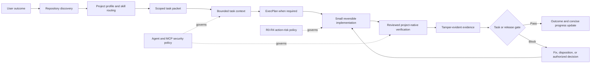

# Architecture

## Layers

1. **Root policy** — concise trusted instructions.
2. **Workflow skills** — the kind of work being performed.
3. **Engineering-area skills** — only the decisions relevant to the task.
4. **Deep references** — loaded on demand.
5. **Deterministic engine** — discovery, routing, commands, evidence, gates, and integrity.
6. **Provider adapters** — OpenAI/Codex, GitHub Copilot, Claude Code, Gemini, Cursor, and Windsurf.
7. **Tests and evals** — regression protection for both runtime and agent behavior.

See `RESEARCH-GAP-ANALYSIS.md` and `RE-AUDIT-REPORT.md` for the design rationale and corrected findings.
